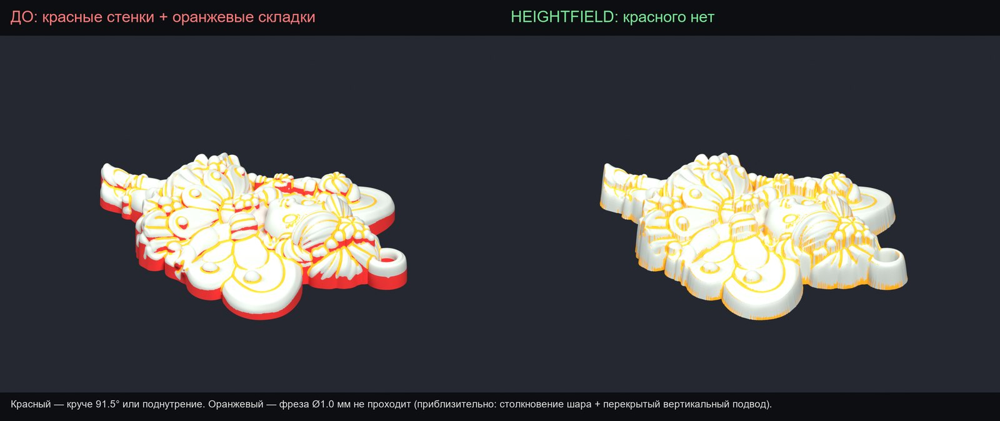
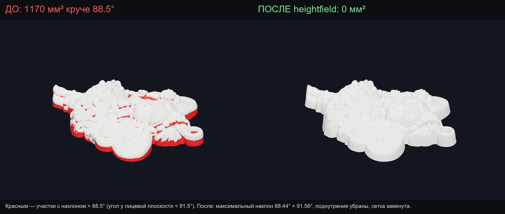

# Brekka

**Фаска и анализ для 3-осевой фрезеровки в Blender.**

Brekka (др.-сканд. «склон, откос») пересобирает рельеф в heightfield с гарантированным уклоном стенок и показывает, где фреза не пройдёт.

## Зачем это

При 3-осевой фрезеровке модели нельзя иметь стенки круче допустимого угла: фреза их не выберет, а на модели останутся складки и поднутрения. Обычно это ловят руками, крутят вид, меряют углы, правят кистью. Brekka делает две вещи.

1. **Пересобирает** модель как heightfield и математически ограничивает наклоны, так что участков круче заданного угла не остаётся. Это не подбор, а гарантия.
2. **Показывает** проблемные места цветом прямо в Sculpt Mode: где не хватает уклона, где не пройдёт конкретная фреза, где щель уже инструмента.

## Возможности

- **Пересборка heightfield**: угол стены, шаг сетки, сглаживание кромки. Оригинал не трогается, создаётся копия `имя_HF`.
- **Юбка**: жертвенное удлинение низа, скульпт деформирует юбку, а не рабочее дно.
- **Ремеш и упрощение**: подбор вокселя под целевое число вершин, Decimate до 1 млн.
- **Анализ для скульпта**: три типа фрезы (шар, плоская, конусная), автообновление после мазка кистью, «Найти точку», «Сгладить».
- **Цветовая карта**: красный значит не хватает уклона или поднутрение, оранжевый значит фреза не пройдёт по углу, маджента значит щель уже фрезы, синий значит юбка, её срезать.

## Установка

1. Blender **4.2+** (проверено на 5.2 LTS).
2. `Edit → Preferences → Add-ons → Install from Disk…` (стрелка справа сверху).
3. Выбрать `brekka.py`, включить **Brekka**.
4. В 3D-окне нажать **N** → вкладка **Brekka**.

Зависимостей нет, только Blender и его numpy.

## Быстрый старт

1. Выделить одну или несколько моделей.
2. Блок **1. Пересборка**: угол стены `91.5`, шаг сетки `0.12`, сглаживание `20`.
3. Нажать **Пересобрать**, получится копия `имя_HF` с гарантированным уклоном.
4. При необходимости: **2. Юбка → Наростить**, поскульптить, срезать юбку булеаном.
5. **4. Анализ** → выбрать фрезу → **Анализ**: проблемные зоны станут цветными.

## Параметры

| Параметр | По умолчанию | Что значит |
|---|---|---|
| Угол стены | 91.5° | Угол между лицевой плоскостью и стенкой (90° это вертикально). Внутри аддон берёт запас 0.7°, на выходе обычно 91.5–91.7°. |
| Шаг сетки | 0.12 мм | Разрешение пересборки. 0.08 детальнее и тяжелее, 0.20 быстро и грубо. |
| Сглаживание кромки | 20 | Проходов лапласиана в полосе ~0.8 мм у контура. 0 значит выключено. |
| Оставить оригинал | вкл | Создать копию `имя_HF`, исходник не трогать. |
| Удлинить дно | 0.5 | Глубина жертвенной юбки. |
| Ø фрезы | свой у каждого типа | Диаметр активной фрезы, в единицах модели (1 единица = 1 мм). |
| Угол конуса | 4.88° | Уклон боковой кромки конусной фрезы. |
| Автообновление | вкл | Пересчитывать подсветку после мазка кистью (до 2.5 млн граней). |

## Ограничения

- Анализ приблизительный: это локальная проверка контакта и хвостовика, а не полная симуляция CAM. Для плоской фрезы оценка грубее, чем для шара.
- Автообновление работает до **2.5 млн** граней, кнопка «Анализ» до **3 млн**. Тяжёлые сетки сначала упрощайте: блок **3. Ремеш → Упростить**.
- Пересборка это пересборка, а не сдвиг: всё, что было круче угла, срезается сверху. Детали мельче примерно 2× шага слегка сглаживаются.
- Не прогоняйте heightfield дважды по одной копии, каждый проход эродирует. Для повторного прохода берите оригинал.

## Участие

Идеи, баги и pull request'ы через Issues. Если аддон помог в работе, напишите, на каких моделях и версиях Blender проверяли, это помогает не сломать чужие пайплайны. Проект под GPL-3.0, можно использовать, менять и распространять.

## Лицензия

[GPL-3.0](LICENSE).

---

## English summary

**Brekka** (Old Norse for slope, hillside) is a Blender add-on for preparing bas-reliefs for 3-axis CNC milling. It rebuilds a mesh as a heightfield with a mathematically guaranteed wall angle, adds a sacrificial skirt for sculpting, and colors the mesh by machinability: steep walls, cutter reach limits and slots narrower than the tool. Three cutter types (ball, flat, tapered 4.88°). Works in Sculpt Mode with live updates. Blender 4.2+ (tested on 5.2 LTS), GPL-3.0.
